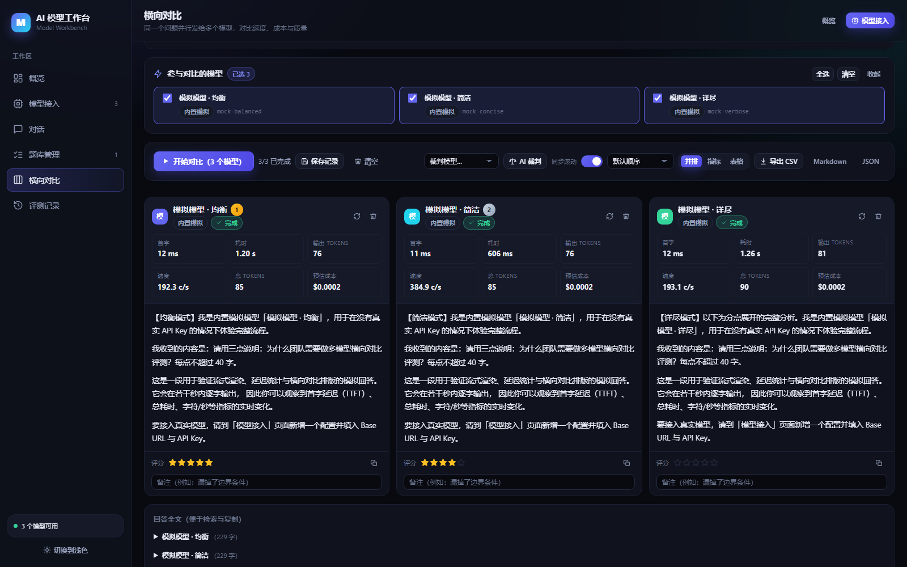
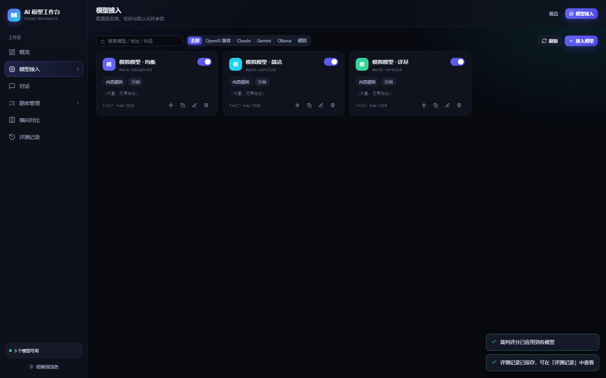
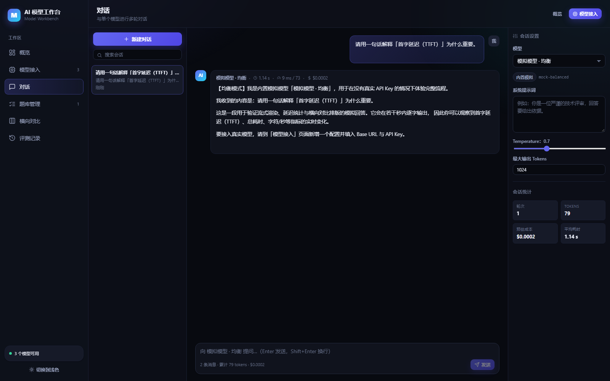
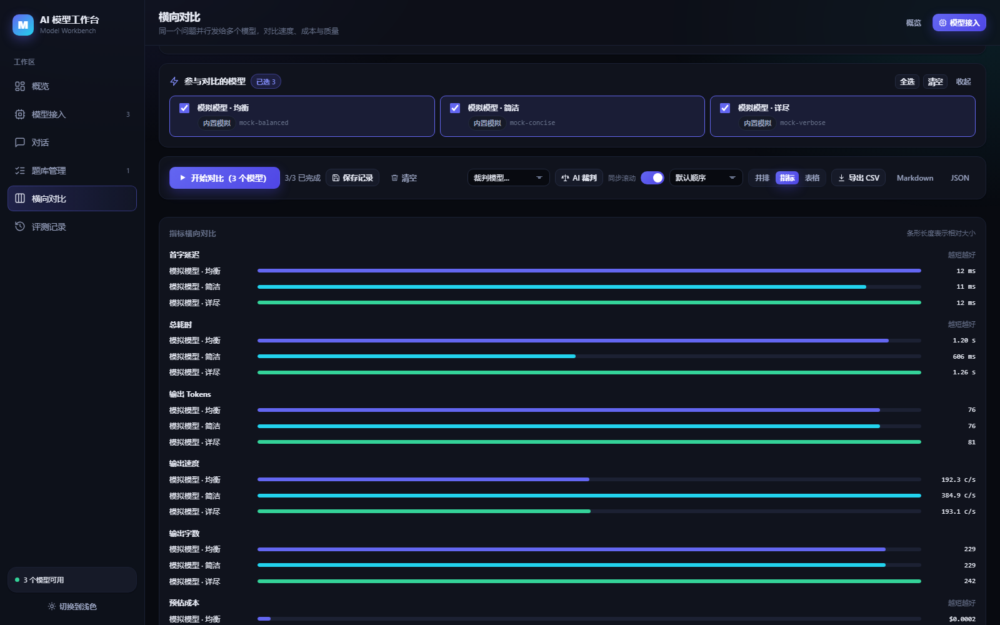
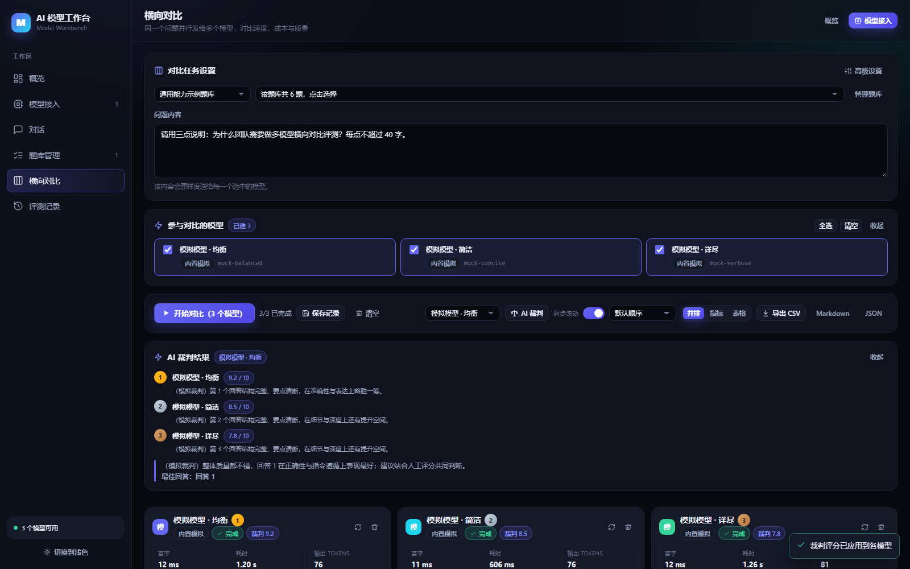
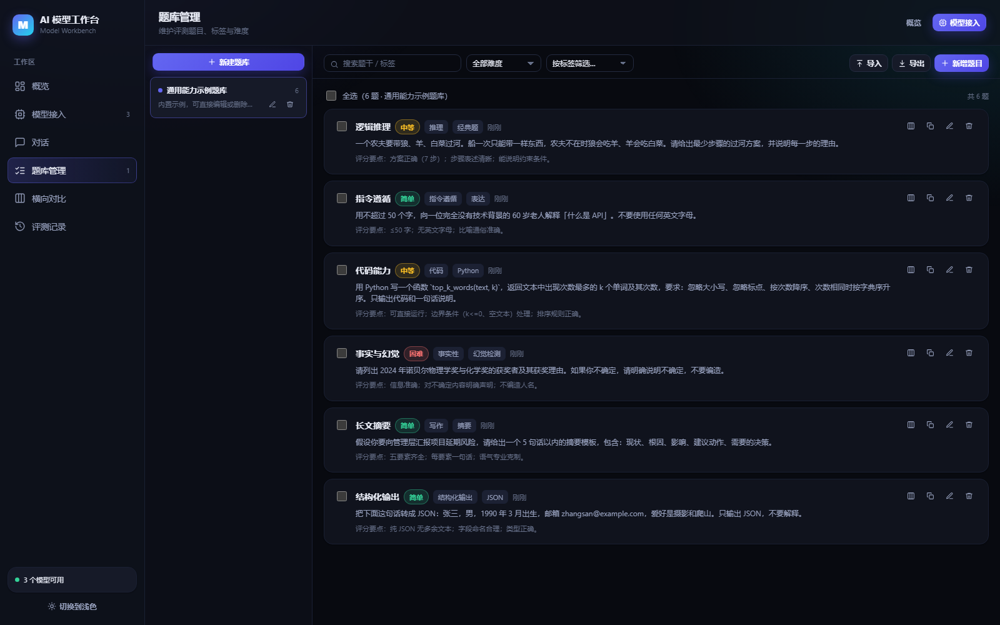
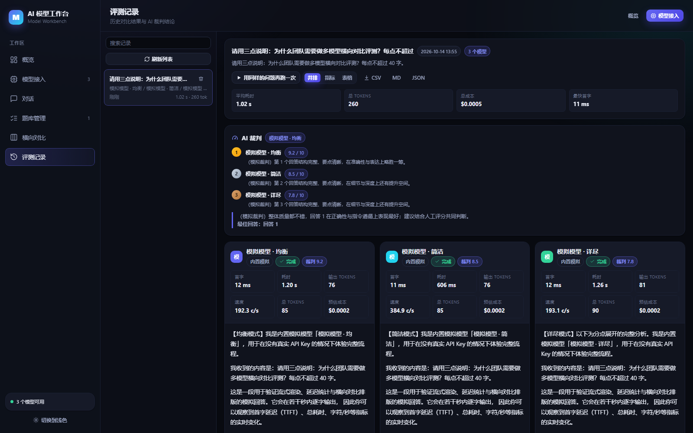

# AI 模型工作台（Model Workbench）

一个本地运行的 Web 工作台，用于**接入多家大模型、日常对话、维护评测题库、把同一个问题同时发给多个模型并横向对比结果**。

适合做模型选型、Prompt 调优、版本回归、成本与延迟评估等场景。所有数据（含 API Key）只保存在本机 `data/` 目录，不上传任何第三方服务器。



---

## 功能一览

| 模块 | 能力 |
| --- | --- |
| **概览** | 模型/题库/题目/评测/对话数量统计，各模型 Token 消耗、难度分布、热门标签、最近评测 |
| **模型接入** | 增删改查、启用停用、连接测试（含首字延迟）、一键拉取上游模型列表、默认采样参数、单价配置 |
| **对话** | 多会话管理、流式输出、Markdown + 代码高亮、思考过程折叠、首字/耗时/Token/成本指标、重新生成、系统提示词 |
| **题库管理** | 多题库、题目增删改查、难度与标签、评分要点、批量选择、JSON/CSV 导入、JSON/CSV/Markdown 导出、一键带入对比 |
| **横向对比** | 同一问题并行流式跑 N 个模型，并排/指标/表格三种视图，同步滚动，实时指标，人工星级评分与备注，AI 裁判自动打分排序，导出 CSV/Markdown/JSON，保存评测记录 |
| **评测记录** | 历史对比完整留档，可回看、导出、用同样的问题再跑一次 |

支持的协议：**OpenAI 兼容**（OpenAI、DeepSeek、通义千问/百炼、Kimi、智谱 GLM、硅基流动、OpenRouter、Groq、xAI、one-api/new-api、LM Studio、vLLM…）、**Anthropic Claude**、**Google Gemini**、**Ollama 原生**，以及一个**免密钥的内置模拟模型**（用于先跑通流程、演示对比）。

---

## 快速开始

要求 Node.js ≥ 20.19。

```bash
npm install          # 安装依赖
npm run build        # 构建前端
npm start            # 启动服务
```

打开 <http://127.0.0.1:8787> 即可。

开发模式（前端热更新，后端自动重启需手动）：

```bash
npm run dev          # API :8787 + Vite :5173
```

### 第一次使用建议

1. 进入「模型接入」，点 **一键添加模拟模型**（不需要任何 Key），先跑通流程；
2. 去「横向对比」，从内置示例题库挑一道题，点 **开始对比**，观察三个模型的延迟、Token 与回答差异；
3. 接入真实模型：点「接入模型」→ 选服务商预置 → 填 API Key → **测试连接**；
4. 用「题库管理」沉淀自己的评测题目，标注难度、标签与评分要点。

---

## 界面预览

| 模型接入 | 对话 |
| --- | --- |
|  |  |

| 指标对比 | AI 裁判 |
| --- | --- |
|  |  |

| 题库管理 | 评测记录 |
| --- | --- |
|  |  |

---

## 目录结构

```
server/                 零依赖 Node 服务
  index.mjs             HTTP 服务 + 静态资源托管 + SPA 回退
  api.mjs               路由层（模型/会话/题库/题目/评测/裁判/统计/导出）
  adapters.mjs          各家协议的流式适配，统一归一化为同一种事件流
  store.mjs             JSON 持久化（防抖 + 原子写入）
web/                    React + TypeScript 前端
  src/pages/            概览 / 模型接入 / 对话 / 题库管理 / 横向对比 / 评测记录
  src/components/       通用组件、Markdown 渲染、结果列与指标面板
  src/lib/              格式化、服务商预置
scripts/
  dev.mjs               同时拉起 API 与 Vite
  smoke.mjs             接口层端到端测试（33 项）
  ui-check.mjs          无头浏览器真实交互测试（25 项）
  screenshot.mjs        生成文档截图
data/                   运行时数据（首次启动自动创建，已 gitignore）
  models.json banks.json questions.json conversations.json runs.json settings.json
```

---

## 工作原理

- 浏览器不直接访问模型厂商接口，而是把请求发给本机服务：`POST /api/chat/stream` 与 `POST /api/run/stream`；
- 服务端按模型配置选择适配器，把不同厂商的 SSE / NDJSON 协议**归一化**成统一事件：`start / delta / reasoning / usage / done / error`，再以 SSE 回推给前端；
- 因此前端只需要一套流式渲染逻辑，就能同时支持 OpenAI 兼容、Claude、Gemini、Ollama；
- 对比模式下前端对每个模型各开一条流（`AbortController` 独立控制），真正并行、互不阻塞，并实时统计**首字延迟（TTFT）**、总耗时、输出 Token、字符/秒与预估成本；
- 上游未返回 usage 时按字符数粗略估算，并在界面上以 `~` 标注。

### 安全说明

- API Key 只在服务端保存，`GET /api/models` 永不返回明文，只返回是否已配置与掩码预览；
- 编辑模型时留空 Key 表示不修改；
- 服务默认只监听 `127.0.0.1`。

---

## 测试与验证

```bash
npm start            # 另开一个终端先启动服务
npm test             # 类型检查 + 接口测试 + 浏览器 UI 测试
```

- `npm run test:api` —— 33 项接口测试：健康检查、模型 CRUD 与密钥脱敏、流式对话、会话持久化、题库与 CSV/JSON 导入、三种格式导出、三模型并行对比、AI 裁判结构化评分、评测记录增改查、统计汇总、错误码与上游异常透传，并在结束后清理测试数据。
- `npm run test:ui` —— 25 项浏览器测试（Chrome DevTools Protocol 真实点击/输入）：页面挂载、模型多选、从题库选题、并行流式渲染、指标区、星级评分、备注、AI 裁判回填、三种视图切换、保存记录、记录详情、对话收发、题库浏览、模型预置回填、明暗主题、窄屏响应式。
- `npm run shots` —— 重新生成 `docs/screenshots/` 下的截图。

---

## 常见问题

**Q：连接测试失败怎么办？**
优先检查 Base URL 是否填到了 `/v1` 这一层（例如 `https://api.deepseek.com/v1`），以及 Key 是否正确。服务端会把上游的错误信息原样带回界面，例如 `上游(DeepSeek) HTTP 401: Authentication Fails`。

**Q：为什么成本显示 `—`？**
在模型的「默认参数」里填写输入/输出单价（美元 / 百万 tokens）。留 0 表示不统计成本。

**Q：本地 Ollama 怎么接？**
服务商选 `Ollama 本地`，Base URL 填 `http://127.0.0.1:11434`，Key 留空，模型 ID 填 `ollama list` 里的名字（如 `qwen2.5:7b`）。如果填的是带 `/v1` 的地址，会自动走 OpenAI 兼容协议。

**Q：数据在哪里？怎么备份？**
全部在 `data/` 目录下的 6 个 JSON 文件，直接复制即可备份；删除 `data/` 会在下次启动时重新生成内置示例题库。

**Q：AI 裁判用的是哪个模型？**
在「横向对比」工具栏右侧的「裁判模型」下拉里选择。建议选用能力较强、且与被测模型不同的模型。裁判会被要求只输出 JSON，若输出无法解析，界面会保留原始输出供查看。
